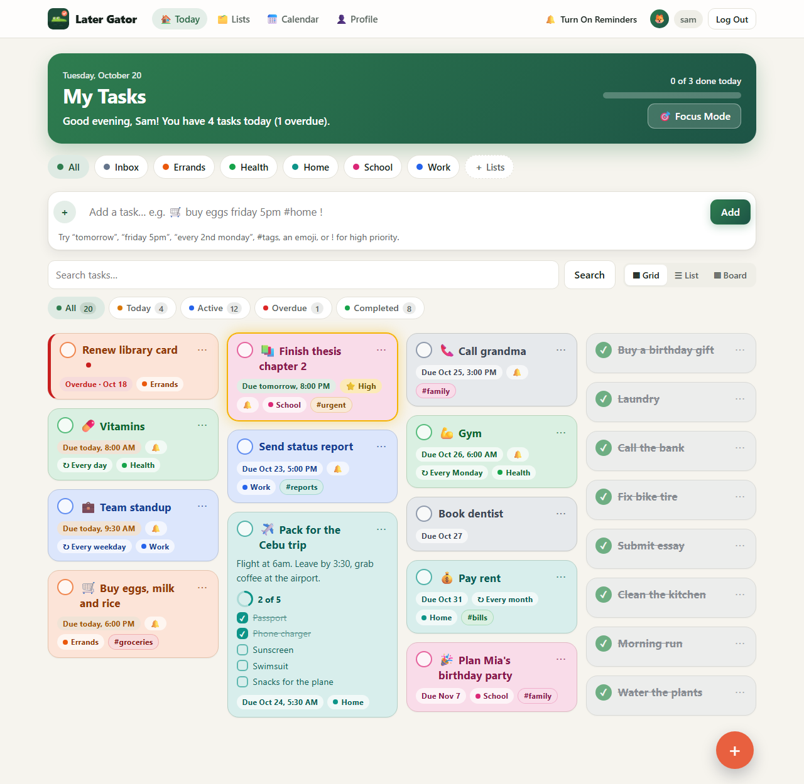
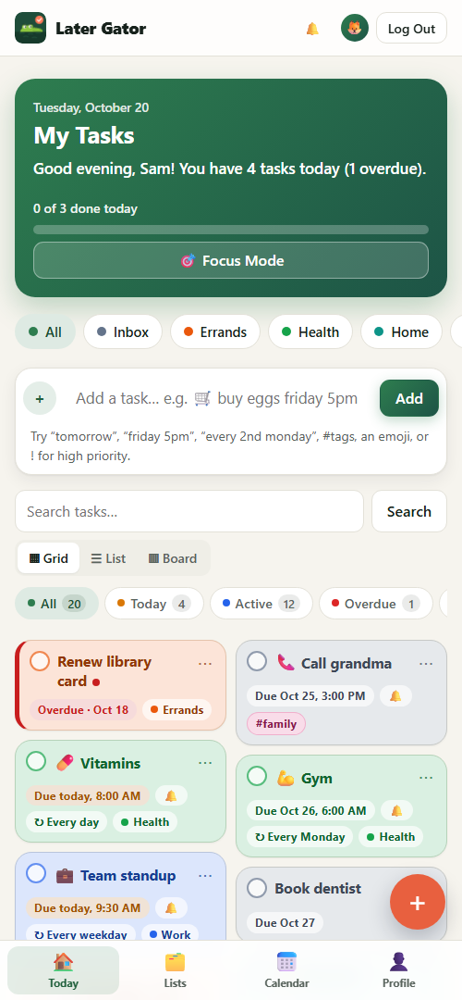
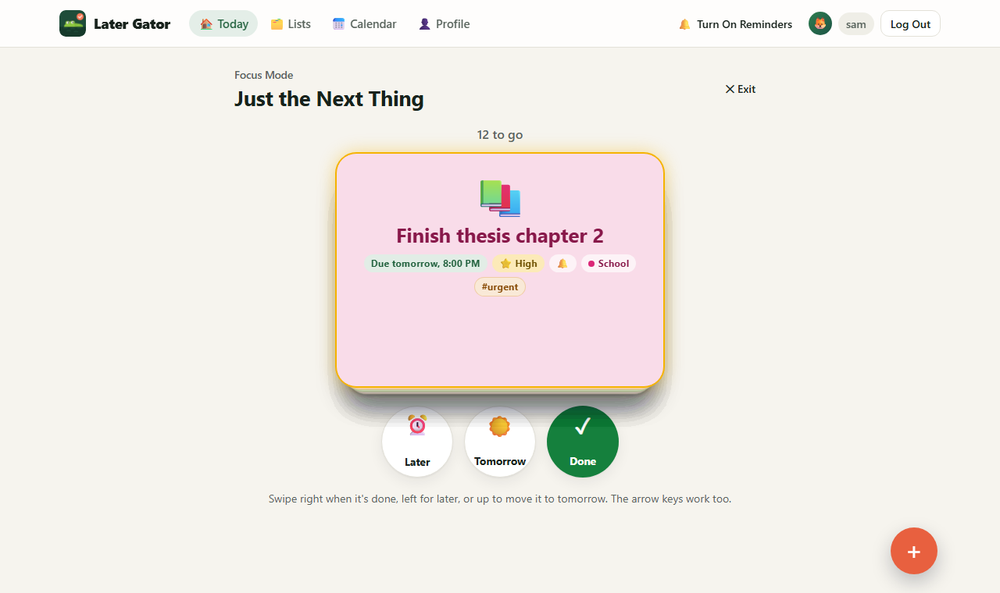
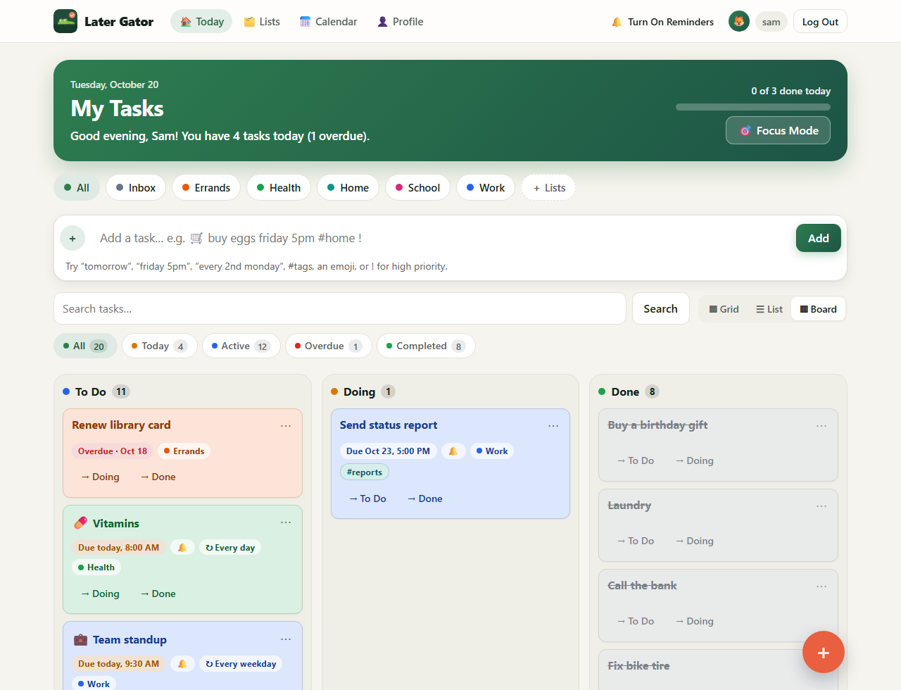
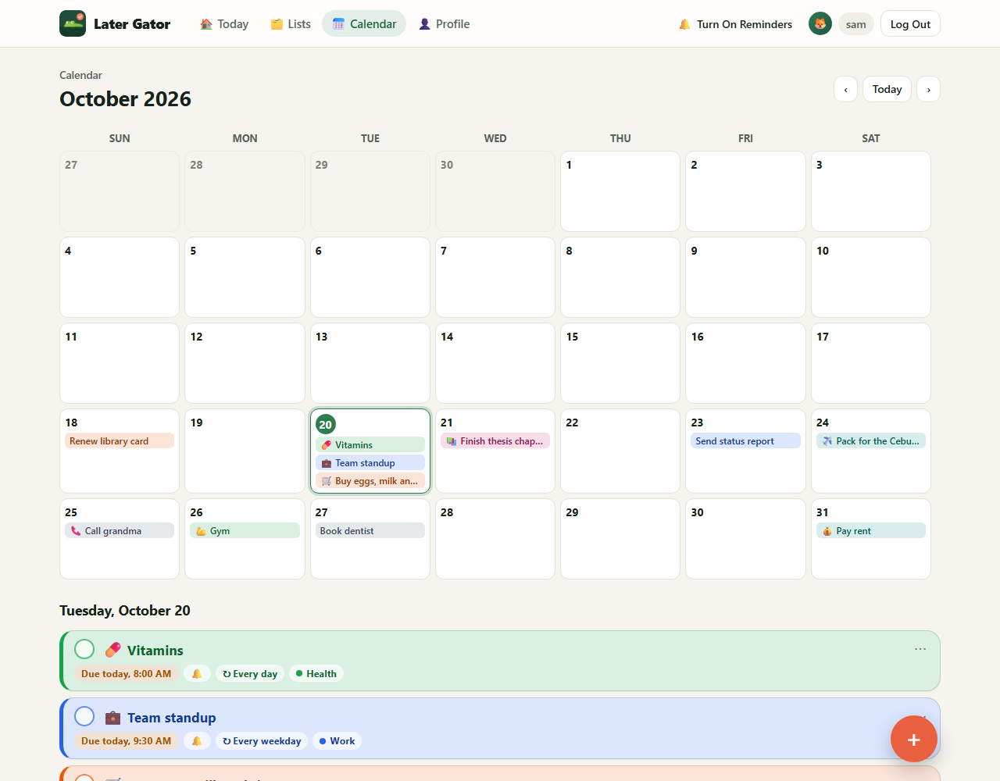
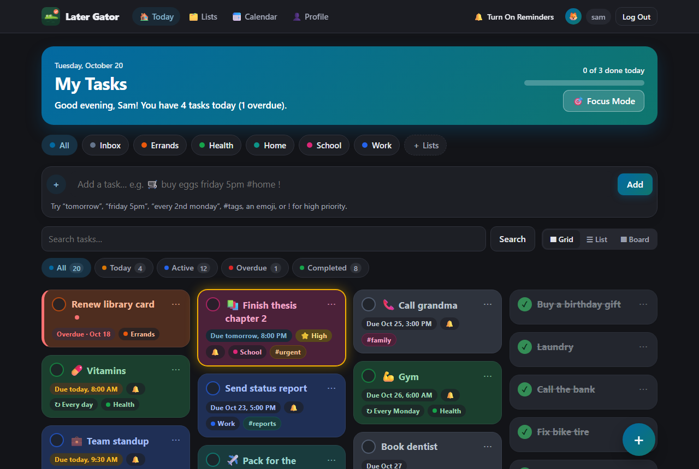
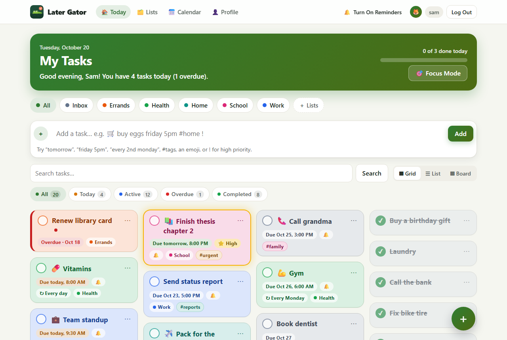
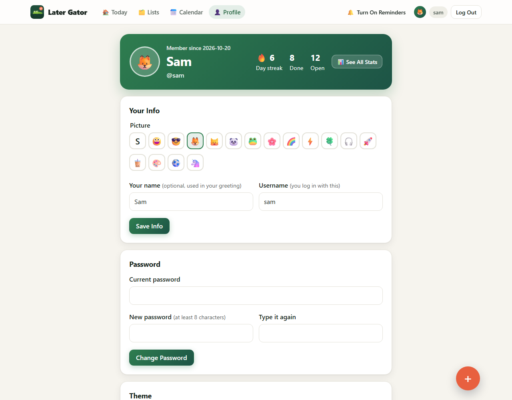
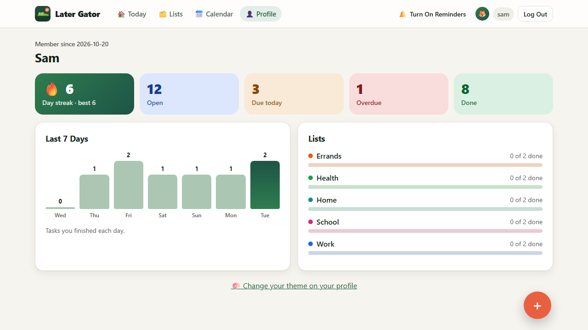
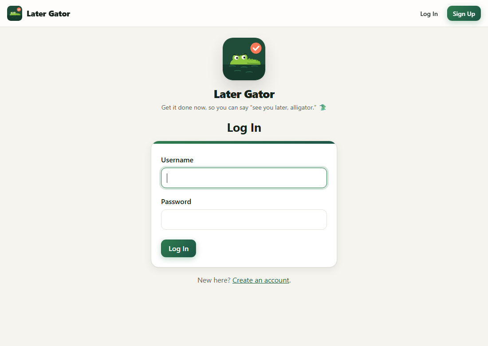

<p align="center">
  
</p>

<h1 align="center">Later Gator</h1>

<p align="center">A colorful to-do list web app built with <b>Python</b>, <b>Flask</b> and <b>SQLite</b>, made to practice CRUD, basic programming logic, forms and validation. 🐊</p>

## Screenshots

The home screen: a greeting with today's progress, list chips, quick add, and a grid of cards colored by list. Cards grow with notes and subtasks, late tasks get a red edge, and high-priority ones a gold glow.



| On a phone | Focus mode: swipe through one task at a time |
|---|---|
|  |  |

| Board: To do, Doing, Done | Calendar |
|---|---|
|  |  |

| Dark mode (Ocean theme) | Matcha theme |
|---|---|
|  |  |

| Profile | Stats |
|---|---|
|  |  |

| Log in |
|---|
|  |

## Features

- **Accounts**: sign up, log in and log out. Each person sees and changes only their own tasks.
- **Quick add**: type one line like `pay rent friday 5pm #home` and press Enter. The app reads the date, time, repeat and tags out of it. It understands `today`, `tomorrow`, day names, `next friday`, `in 3 days`, `oct 25`, `5pm`, `17:30`, `noon`, repeats like `every day`, `every 2 weeks`, `every weekday` or `every 2nd monday`, `#tags`, `!` for high priority, and an emoji like 🛒.
- **Create** tasks with the full form too: title, description, due date and time, repeat, reminder, list, tags, an emoji, high priority and subtasks.
- **Edit** a task.
- **Complete** a task, or mark it as not done again. Completing a repeating task creates the next one.
- **Delete** a task. A toast with an **Undo** button follows a delete or a complete, so mistakes don't hurt.
- **Lists** (projects) like Work or Home, each with one of 8 colors, plus an Inbox for tasks in no list. The Lists page renames, recolors and deletes them. Deleting a list moves its tasks to the Inbox.
- **Tags**: click a tag to see only the tasks that have it. Each tag always gets the same color.
- **Three layouts**: a Pinterest-style **grid** of pastel cards in their list's color (cards grow with notes and subtasks), a compact **list**, or a **board** with To do, Doing and Done columns. Drag cards between columns.
- **Subtasks** with a progress ring on the card, like "2 of 5".
- **Quick actions**: long-press a card (or tap ⋯) to edit, move to tomorrow, change priority, move to another list or delete.
- **Focus mode**: one task at a time. Swipe right when it's done, left for later, up for tomorrow.
- **Calendar**: a month of days with their tasks.
- **Stats**: your streak, tasks done in the last 7 days, and progress per list.
- **Profile**: pick a picture (an emoji), set the name your greeting uses, change your username or password, and choose a theme: Gator (green, the default), Grape, Ocean, Matcha or Sunset, in light or dark. Matcha unlocks at a 3-day streak and Sunset at 7.
- **Nice touches**: a greeting with today's progress bar, confetti when a task is done, a floating + button with a quick-add sheet, and a bottom bar on phones.
- **Today view**: what's due today, plus anything late.
- **Filter** the list with the tabs: All, Today, Active, Overdue and Completed. Each tab shows how many tasks it holds.
- **Search** tasks by title, description and tag.
- **Due date labels**: "Overdue" in red, "Due today", "Due tomorrow" or the date itself, with the time if there is one.
- **Reminders**: a message on the page, and a browser notification if you allow it, when a reminder comes due. They only work while the app is open in a browser tab.
- **Validation**: a form with mistakes is shown again with a message under each field, and what you typed is kept.

## Setup (Windows, PowerShell)

Python 3.13 is installed at `%LOCALAPPDATA%\Programs\Python\Python313` but isn't on PATH, so typing `python` opens the Microsoft Store. Create the virtual environment from the full path once. After that, use the `.venv` copy.

```powershell
& "$env:LOCALAPPDATA\Programs\Python\Python313\python.exe" -m venv .venv
.venv\Scripts\python -m pip install -r requirements.txt
```

## Run

```powershell
.venv\Scripts\flask --app todo run --debug
```

Then open http://127.0.0.1:5000. The database (`instance/todo.sqlite`) is created automatically on first run.

Open **Sign up** to create an account. To delete every task and account and start fresh, run `.venv\Scripts\flask --app todo init-db --reset`.

Tasks made before accounts were added have no owner, so they no longer show up. When the app starts, it adds any missing columns to an old database automatically.

## Test

```powershell
.venv\Scripts\python -m pytest
```

## What each file teaches

| File | Topic |
|---|---|
| `todo/__init__.py` | The app factory: building the Flask app and its settings |
| `todo/schema.sql` | Designing tables: column types, `NOT NULL`, defaults, `UNIQUE`, linking a task to its user and list, and a many-to-many table for tags |
| `todo/db.py` | Opening and closing a database connection per request; upgrading an old database with `ALTER TABLE`; a custom `flask` command |
| `todo/tasks.py` | **CRUD**: `INSERT`, `SELECT`, `UPDATE` and `DELETE` with safe `?` placeholders, and a `JOIN`. **Logic**: filtering, counting, sorting and due-date labels. Post/Redirect/Get. A small JSON API (`/reminders`). Saving undo data as JSON |
| `todo/lists.py` | `GROUP BY`, `LEFT JOIN`, `SUM()` and `COALESCE()` to count tasks per list |
| `todo/pages.py` | The `calendar` module, `Counter`, and working out streaks from dates |
| `todo/profile.py` | Updating your own account: checking the current password before changing it, and three forms on one page |
| `todo/quickadd.py` | **Parsing text** with regular expressions: named groups, whole-word matching, cutting matches out of a string |
| `todo/recurrence.py` | **Date logic**: adding days, weeks and months, the 2nd Monday of a month, and stepping past old dates |
| `todo/static/style.css` | **CSS**: variables, `color-mix()`, gradients, a responsive card grid with `auto-fill`, the same HTML in two layouts with `grid-template-areas`, and breakpoints |
| `todo/static/reminders.js` | **JavaScript**: `fetch()`, timers, browser notifications and `localStorage` |
| `todo/static/app.js` | **JavaScript**: pointer events for a long press, animations, drag and drop |
| `todo/static/focus.js` | **JavaScript**: a swipeable card stack with pointer capture, and keyboard shortcuts |
| `todo/validation.py` | **Validation**: trimming input, required fields, length limits, date parsing, regular expressions, and rules that depend on other data |
| `todo/auth.py` | **Logins**: password hashing, the session cookie, `g.user`, and why logout is a POST |
| `todo/csrf.py` | Why every POST form carries a hidden token |
| `todo/templates/` | **Forms** with Jinja: showing errors per field, keeping typed values, template inheritance, and macros (`_macros.html`) shared by several pages. Popovers that open without JavaScript |
| `tests/` | Testing with pytest: plain function tests and fake web requests |

## Ideas to practice next

- Add a **priority** field (Low, Medium, High). You'll touch `schema.sql`, `validation.py`, `form.html`, `index.html` and the tests.
- Add a "Clear completed" button that deletes every finished task in one `DELETE ... WHERE completed = 1`.
- Sort by priority, or let the user choose the sort order.
- Add `novalidate` to the form in `form.html` to watch the server-side validation catch bad input on its own.
- Teach quick add a new word, like `weekend` for the coming Saturday. Start with a test in `tests/test_quickadd.py`.
- Add a "Clear done subtasks" button on the edit page.
